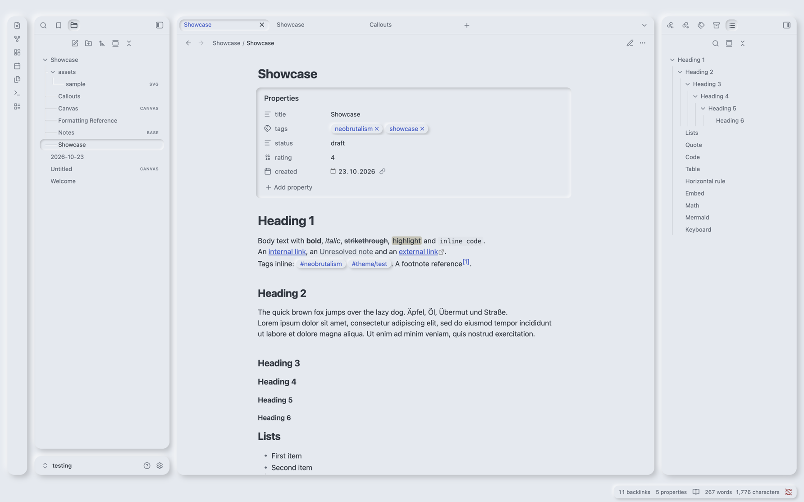
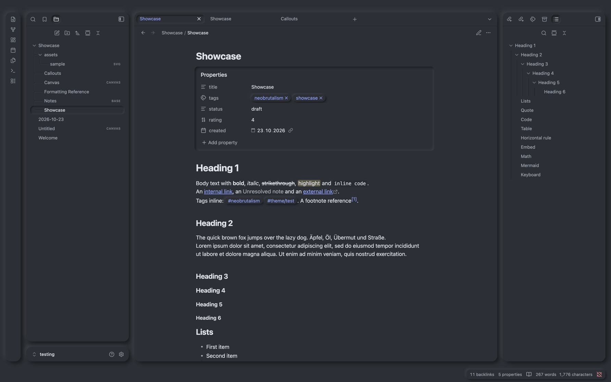

# Neumorphism Theme

A soft theme for [Obsidian](https://obsidian.md) in the neumorphic style. The whole interface is shaped from one material: panels, buttons and cards are raised out of the background, inputs and pressed elements are pressed into it. Light always comes from the top left, and color is used only as an accent.

## Preview

## Features

- **Floating panels**: every tab group, the ribbon and the status bar are raised panels with even spacing, no matter how you split, move or collapse them.
- **Consistent relief**: raised means "can be pressed", inset means "pressed, active or input". Buttons, toggles, checkboxes, tabs, menus, the command palette and the settings window all follow this rule.
- **Light and dark mode** with the relief derived from a single base color.
- **Soft callouts**: raised cards with a light tint of their color.
- **Connected tree lines** in the file explorer, engraved into the surface.
- **Every view styled**: editor, reading view, canvas, graph, bases, settings and mobile.
- **Readable**: body text above 7:1 contrast, accent and callout colors above 4.5:1.

## Style Settings

Install the [Style Settings](https://github.com/mgmeyers/obsidian-style-settings) plugin to adjust the theme:

- **Layout**: gap between panels, gap on phones, tab bar height, hide the status bar
- **Relief and shape**: relief depth, softness, shadow and highlight strength (per mode), corner radii, images without relief, tree lines, transitions
- **Colors**: base color, text, accent (or Obsidian's accent color), a lighter paper surface for notes
- **Typography**: embossed headings

## Upgrading from 1.x

Version 2.0 is a complete redesign. The Style Settings options have new IDs, so settings made with 1.x are not carried over:

| 1.x | 2.0 |
| --- | --- |
| Panel gap (`gap`, rem) | Gap between panels (`nm-gap`, px) |
| Border radius (`border-radius`) | Corner radius of panels (`nm-radius`) |
| Header height (`header-height`) | Tab bar height (`nm-header-height`) |
| Show left sidebar (`show-left-sidebar`) | Removed, use Obsidian's "Show ribbon" setting |
| Light/dark background, shadow, highlight | Base color (`nm-base`) plus shadow and highlight strength |

## Troubleshooting

If something looks wrong, please open an issue in the repository with a screenshot and your Obsidian version.
